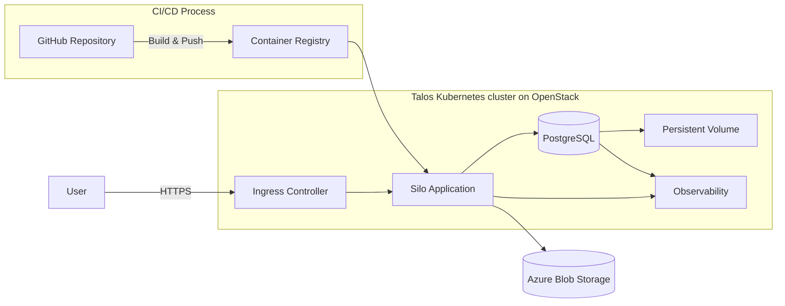

# Design Document: Group 13 - SILO

## 1. Overview

Users need a way to store files reliably and share them with selected teammates without losing control over ownership, access permissions, or storage usage. Building these guarantees into a multi-user cloud service is difficult because storage, authorization, quotas, collaboration, and reliability must work together.

To solve that problem we build the Silo. It is a multi-user file storage service. Users upload and manage files through a web interface within role-based storage quotas. Specific roles can create teams and share files internally. Additionally, all users can generate direct download links, allowing anyone to view and download files without logging in. The platform provides secure, durable, and group-focused storage. 

- **Core goals and features:**
    1. Web app and API with ownership, roles, and quotas: authenticated users can upload, list, download, and delete only their own files. Each role has a storage quota, and users cannot exceed theirs.
    2. Secure deployment of the application, which runs on the university OpenStack cloud (course-provided Talos Kubernetes cluster), while file contents are stored in Azure Blob Storage
- **Success:** Demonstration: A live demo on the deployed URL
- **Explicitly out of scope:** a custom web UI in React, LLM features, and splitting the system into microservices.

## 2. Architecture

Include one high-level diagram showing the main components, their interactions,
and important data flows. Adapt or replace the example below; do not add
components that your project does not need.

**Components**
- **Talos Kubernetes cluster on OpenStack:** orchestrates the application. It provides container scheduling, health checks, service discovery, and secret management.
- **Ingress Controller:** handles incoming HTTPS traffic to the Kubernetes cluster. It provides TLS termination and routes requests to the appropriate Kubernetes services. It can also distribute traffic across multiple FastAPI replicas, allowing the application to scale horizontally.
- **Silo Application:** handles authentication, role/ownership/team checks, quota enforcement, file operations, and renders the HTML pages directly.
- **PostgreSQL:** stores users, roles, teams, team membership, file metadata, quotas, and the audit log. PostgreSQL runs as a Kubernetes StatefulSet and uses persistent storage through a PersistentVolumeClaim (PVC).
- **Observability:** the system exposes application and Kubernetes health and operational data through metrics, logs, and health checks.
- **Azure Blob Storage:** stores file contents separately from the application and database, in private containers (one per environment) of one storage account.
- **CI/CD Process:** builds and tests the application container, performs vulnerability scanning, and publishes the resulting image to a container registry. Kubernetes uses this image to run the FastAPI application.
- **GitHub Repository:** source code is stored in GitHub.

**Main data flow:** a browser sends a request through the ingress controller to the FastAPI application. For an upload, the application verifies authentication, ownership, role and quota, stores the file in Azure Blob Storage, and records its metadata in PostgreSQL. Download and delete operations first perform an ownership or team-membership check. Team membership grants view and download access only; deleting a file or changing its visibility remains restricted to the owner.

**State:** the FastAPI application is stateless. All persistent application state is stored in PostgreSQL and Azure Blob Storage. PostgreSQL data is persisted through a Kubernetes PersistentVolume (PV) and PersistentVolumeClaim (PVC).

## 3. Technologies

List only significant technologies and cloud services, not every library or
development tool.

| Technology / Service | Role in the system | Why chosen (brief) |
| -------------------- | ------------------ | ------------------ |
| Python + FastAPI | Application and API | Fast to build; serves both the API and the HTML pages. |
| Jinja2 + Bootstrap | Server-rendered UI | No separate frontend build or JS framework; fits the small time budget |
| PostgreSQL | Metadata and quota store | Metadata, roles, teams, quotas, audit log. |
| Azure Blob Storage | Object storage for file bytes | Cheap, durable object storage with a mature Python SDK; already verified in our student subscription. |
| Docker | Packaging | One image runs identically on developer laptops, in GitHub Actions CI, and in the Talos cluster. |
| Docker Compose | Local development | Runs the app and a Blob Storage emulator on a laptop, so development needs no cloud resources. |
| Talos Kubernetes | Deployment platform | Course-provided cluster; handles container lifecycles, liveness/readiness probes, and secure configuration. |
| Traefik | Ingress Controller, TLS, routing, and load balancing | Integrates well with Kubernetes and provides the required networking features with low configuration overhead.|
| Prometheus + Grafana | Metrics and dashboard | Provides visible operational evidence for the demonstration and final report. |
| GitHub Actions + self-hosted runner | CI/CD | Automated tests, image build, vulnerability scan, deployment to dev and approval-gated deployment to prod. A runner inside the university network can reach the cluster, which GitHub-hosted runners cannot. |
| GitHub Container Registry | Image storage | Free, integrated with GitHub Actions; stores the Silo application image. |

## 4. Deployment and Operations

Describe the planned deployment at a high level. Exact, reproducible commands
belong in `report.md`.

- **Target environment:** compute and the database run on the university OpenStack: a Talos Kubernetes cluster hosts the API and PostgreSQL, and one VM hosts the self-hosted CI runner. File bytes are stored on Microsoft Azure in one Storage account using Blob Storage.
- **Infrastructure and data:** the system runs on virtual machines in the university's OpenStack environment, using a private network and security rules. PostgreSQL uses persistent storage provided through Kubernetes PV/PVC.
- **Configuration and secrets:** non-sensitive configuration is managed through environment variables and Kubernetes ConfigMaps. Sensitive credentials, including database credentials, the Azure Storage access credential (account key or connection string), and the JWT signing key, are stored using Kubernetes Secrets and are not committed to the source code repository.
- **Security:** JWT-based authentication with hashed passwords, per-request ownership and team access checks, role-based and global storage quotas, rate limiting, TLS, upload size and file-type validation, and audit logging. Files are stored in a private Blob container (public access disabled, HTTPS-only transfer enforced on the storage account), and all downloads go through the API so access checks are applied in one place.
- **Operations:** Kubernetes startup, readiness, and liveness probes are used to monitor application startup, availability, and health; readiness also verifies connectivity to PostgreSQL and Azure Blob Storage. The system provides structured logs and a `/metrics` endpoint for observability.
- **Cost:** compute and PostgreSQL run within the university's OpenStack quota at no direct monetary cost; the limiting resources there are vCPU, RAM, and storage capacity. Azure Blob Storage is paid from the Azure for Students credit.

## 5. Scope and Feasibility

Explain why the project is achievable within the course and how it emphasizes
cloud infrastructure or operations rather than frontend work.

Summarize the scope, milestones, and ownership. Three to five rows are usually enough.

 - Student A = Oliwier
 - Student B = Stefan

| Milestone / Deliverable | Core or stretch | Owner(s) | Target |
| ----------------------- | --------------- | -------- | ------ |
| **Infrastructure and application foundation:** OpenStack access, Azure access, Talos/Kubernetes environment, FastAPI skeleton, authentication, PostgreSQL, and basic CI/CD | Core | A + B | Week 1 (~12h) |
| **Core functionality:** roles, quotas, teams, file upload/download/delete, Azure Blob Storage integration, and access control | Core | A (roles/teams/quotas), B (Blob/files) | Week 2 (~16h) |
| **Web interface and operations:** Jinja2/Bootstrap pages, team sharing, backups, cleanup, observability, secrets, and TLS deployment | Core | A (ops), B (UI/sharing) | Week 3 (~18h) |
| **Validation and delivery:** security testing, threat model, backup restore test, final report, and demonstration | Core | A + B | Week 4 (~10h) |
| **Optional extensions:** ClamAV malware scanning, automatic file tagging, HashiCorp Vault, sharing links, and additional admin analytics | Stretch | A + B | If time allows (~4h buffer) |

**Fallbacks:**
 - *Object storage fallback:* storage is accessed through a small `StorageBackend` interface, so the backend can be swapped without changing the rest of the application. If Azure Blob Storage becomes unusable (region restrictions on the student subscription, the cluster cannot reach Azure, or the credit runs out), we switch to OpenStack Swift, which we have already verified on our account, or to an S3-compatible service on OpenStack.
 - *Database storage fallback:* deploying PostgreSQL on a dedicated stateful VM if persistent storage cannot be reliably provided in the Talos Kubernetes cluster.